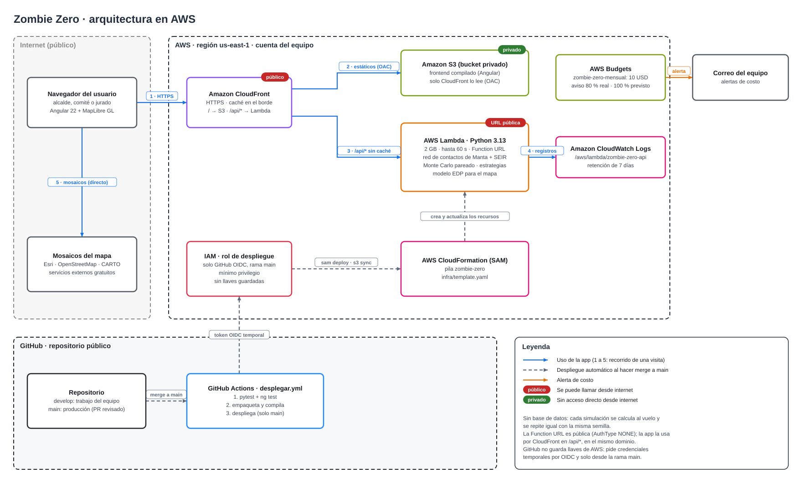

# 🧟‍♀️ Zombie Zero — Comité de Contención de Manta

Herramienta que simula cómo se propaga una plaga en una red de contactos de
Manta (hogares, colegios, trabajo, buses y el Mercado Central) y recomienda
**a quién vacunar, dónde y cuándo** con recursos limitados. Compara la
estrategia propuesta contra dos líneas base (no intervenir y vacunar al azar)
con miles de simulaciones, y reporta cuánta gente se salva.

> Hackathon · Track B · La Plaga Zombie

**Estados:** 🟢 Sano (S) · 🟡 Mordido (E) · 🔴 Zombie (I) · 🔵 Exorcizado (R)

## Contenido

- [Qué hace](#qué-hace)
- [Cómo probarlo](#cómo-probarlo)
- [Parámetros por defecto y semilla](#parámetros-por-defecto-y-semilla)
- [Cómo desplegarlo](#cómo-desplegarlo)
- [Arquitectura](#arquitectura)
- [Decisiones de diseño](#decisiones-de-diseño)
- [Supuestos y fuentes](#supuestos-y-fuentes)
- [Limitaciones conocidas](#limitaciones-conocidas)
- [Costos](#costos)
- [AWS Budget](#aws-budget)
- [Equipo y flujo de trabajo](#equipo-y-flujo-de-trabajo)

## Qué hace

**Aplicación desplegada:** https://dehwt6pb3rwca.cloudfront.net

**La historia:** un avión llega a Manta lleno de zombies. Los bomberos y médicos que lo abren son mordidos
sin saberlo y vuelven a casa. Desde ahí la plaga avanza por hogares, colegios, buses, trabajos y el Mercado
Central. El Comité de Contención tiene pocas vacunas, un presupuesto limitado y se entera del brote tarde.

1. **Simula la propagación día a día** con un modelo SEIR sobre una red de contactos de 5.000 personas de
   Manta, armada con datos del Censo 2022 del INEC.
2. **Prueba planes de intervención** con los mismos recursos: dos estrategias de vacunación (superpropagadores
   y vacunación en anillo alrededor de los zombies detectados), solas o combinadas con el cierre del mercado y
   de los colegios, siempre dentro del presupuesto.
3. **Compara contra dos líneas base:** no intervenir y repartir las mismas vacunas al azar.
4. **Repite cada plan 100 veces** (Monte Carlo) con la misma "suerte" para todos los planes y reporta la media,
   la mediana y el rango p5–p95 de infectados, cuántas personas se salvan y en qué porcentaje de los brotes el
   plan le gana al azar.
5. **Recomienda un plan en lenguaje simple** y dice qué tan sólida es la recomendación.
6. **Muestra el avance en un mapa animado de Manta** (modelo de difusión espacial): se reproduce día por día
   con ▶ y tres velocidades, o se recorre a mano con el deslizador (en simulaciones de más de 180 días,
   un fotograma cada 2 días o más, por el límite de 6 MB de respuesta de Lambda).

Todo se calcula en vivo con cada cambio de parámetros, sin resultados guardados de antemano. En la interfaz se
cambian el punto de origen del brote, el R0, la detección, el presupuesto, las vacunas, su eficacia, el día
en que se empieza a actuar, las vacunas por día, la población, la duración y la semilla.

7. **Recalcula ante imprevistos:** se puede simular un corte en la entrega de vacunas (por ejemplo, un bloqueo
   de la vía desde el día 21 durante 30 días). Al reanudarse la entrega, cada plan vuelve a decidir con el brote
   de ese día, y la recomendación puede cambiar: con ese corte pasa de *anillo + cerrar colegio* a
   *centralidad + cerrar colegio*.

## Cómo probarlo

El repositorio tiene dos partes independientes que se comunican por HTTP:

- `backend/`: motor de simulación y API en Python.
- `frontend/`: interfaz web.

### Requisitos

- Python 3.11 o superior
- Node.js 22.22 o superior (para el frontend)

### 1. Backend

Una sola vez, para crear el entorno e instalar las dependencias:

```bash
cd backend
python -m venv .venv
.venv/bin/pip install -e ".[dev]"
```

Pruebas (deben pasar todas antes de cada push):

```bash
.venv/bin/python -m pytest -q
```

Levantar la API en `http://127.0.0.1:8000`, que es la que usa el frontend:

```bash
.venv/bin/python -m zombie.servidor
```

Para comprobar que responde: `http://127.0.0.1:8000/api/salud` devuelve
`{"estado": "ok"}`. Los endpoints están en [docs/api.md](docs/api.md).

Simular desde la terminal, sin interfaz (útil para el Brote Sorpresa):

```bash
.venv/bin/python -m zombie.cli                                   # escenario por defecto
.venv/bin/python -m zombie.cli --r0 5 --vacunas 500 --inicio mercado
.venv/bin/python -m zombie.cli --help                            # todos los parámetros
```

En Windows, cambia `.venv/bin/python` por `.venv\Scripts\python`.

### 2. Frontend

Con la API corriendo en otra terminal:

```bash
cd frontend
npm install
npm start        # http://localhost:4200
```

Detalles y arquitectura en [frontend/README.md](frontend/README.md).

### 3. En la nube

La versión desplegada está en https://dehwt6pb3rwca.cloudfront.net. La API responde en el mismo dominio:

```bash
curl https://dehwt6pb3rwca.cloudfront.net/api/salud
curl -X POST https://dehwt6pb3rwca.cloudfront.net/api/simular \
     -H 'content-type: application/json' -d '{}'      # escenario por defecto, ~10 s
```

## Parámetros por defecto y semilla

Los valores viven en [`backend/src/zombie/config.py`](backend/src/zombie/config.py) y cada uno está
justificado en [docs/supuestos.md](docs/supuestos.md).

| Grupo | Parámetro | Valor por defecto |
|---|---|---|
| Escenario | Población simulada | 5.000 personas |
| | Duración | 180 días |
| | **Semilla** | **42** |
| | Origen del brote | Aeropuerto: 5 rescatistas mordidos |
| Plaga | R0 | 2,5 |
| | Latencia (mordido → zombie) | 3 días |
| | Periodo infeccioso (zombie → exorcizado) | 5 días |
| | Zombies que se detectan | 40 % |
| Recursos | Presupuesto | 20.000 USD |
| | Costo por vacuna | 10 USD |
| | Vacunas disponibles | 500 (10 % de la población) |
| | Vacunas por día | 50 |
| | Día en que se empieza a actuar | 21 |
| | Corte de vacunas (imprevisto) | Sin corte (0 días) |
| | Eficacia de la vacuna | 90 % |
| | Cierre de mercado / colegios | 600 / 800 USD por día, 14 días, 80 % de cumplimiento |
| Monte Carlo | Repeticiones por plan | 100 en la web y la API (límite de 60 s), 1.000 en la CLI |

**Resultado de referencia** (escenario por defecto, semilla 42, 100 repeticiones), en infectados promedio:

| Plan | Infectados | Rango p5–p95 |
|---|---|---|
| Sin intervenir | 2.204 | 8 – 2.732 |
| Vacunas al azar | 1.795 | |
| **Recomendado: anillo + cerrar colegios** | **546** | 7 – 1.768 |

La recomendación le gana al azar en el 100 % de los brotes en que hubo diferencia (veredicto "sólida") y salva
en promedio unas 1.660 personas frente a no intervenir. En el 14 % de los brotes la plaga se apagó sola antes del
día 21 y todos los planes terminaron igual; esos empates se reportan aparte.

**Para reproducirlo:** abrir la web sin cambiar nada y pulsar simular, o `POST /api/simular` con `{}`. Con la
misma configuración y la misma semilla el resultado es idéntico, en local y en AWS. Cada repetición usa
`SeedSequence([semilla, repetición])`, así que el resultado tampoco depende de cómo se reparte el cálculo.

## Cómo desplegarlo

Todo está en `infra/` y se despliega en `us-east-1` con una sola plantilla
(`infra/template.yaml`):

| Recurso | Para qué |
|---|---|
| Lambda (Python 3.13, 2 GB, 60 s) + **Function URL** | La API. Function URL en vez de API Gateway porque una simulación puede pasar de los 30 s que permite API Gateway |
| S3 privado + CloudFront | La interfaz web en Angular |
| AWS Budget | Alerta por correo al 80 % del gasto mensual y si el pronóstico pasa del 100 % |
| CloudWatch Logs | Logs de la API, guardados 7 días |

Requisitos: [AWS CLI v2](https://docs.aws.amazon.com/cli/latest/userguide/getting-started-install.html),
[SAM CLI](https://docs.aws.amazon.com/serverless-application-model/latest/developerguide/install-sam-cli.html)
y [uv](https://docs.astral.sh/uv/). Las credenciales nunca van en el repositorio:

```bash
aws configure sso                  # una vez; región us-east-1
aws sso login                      # cada vez que expire la sesión
aws sts get-caller-identity        # comprueba la cuenta

CORREO_ALERTA=equipo@ejemplo.com infra/desplegar.sh
```

`desplegar.sh` arma el paquete de la Lambda (`infra/empaquetar.sh` descarga
numpy compilado para Lambda, sin Docker), despliega la pila `zombie-zero` e
imprime `ApiUrl` y `FrontendUrl`. Para publicar la interfaz después de
compilarla:

```bash
infra/publicar-frontend.sh frontend/dist/zombie-zero-ui/browser
```

Para borrar todo: `aws cloudformation delete-stack --stack-name zombie-zero`
(antes hay que vaciar el bucket del frontend).

## Arquitectura



Archivo fuente editable: [`docs/arquitectura.drawio`](docs/arquitectura.drawio) (se abre en [diagrams.net](https://app.diagrams.net)).

- **Región:** us-east-1. Todo es serverless y se define en [`infra/template.yaml`](infra/template.yaml) (SAM).
- **Público:** CloudFront (la única URL que usa la app) y la Function URL de la Lambda.
  **Privado:** el bucket S3, que solo CloudFront puede leer mediante OAC.
- **Flujo de una visita:** el navegador pide la página a CloudFront, que la toma de S3. Las simulaciones van
  a `/api/*` en el mismo dominio y CloudFront las pasa a la Lambda sin caché (hasta 60 s). La Lambda arma la
  red de contactos, corre el Monte Carlo y devuelve el resultado; no hay base de datos, porque con la misma
  semilla el resultado es siempre el mismo. Los mosaicos del mapa los pide el navegador directamente a Esri,
  OpenStreetMap y CARTO.
- **Despliegue:** cada merge a `main` corre las pruebas en GitHub Actions y, si pasan, despliega con un rol de
  IAM que se obtiene por OIDC. No hay llaves de AWS guardadas en GitHub y el rol solo puede tocar los recursos
  de esta aplicación ([`infra/github-oidc.yaml`](infra/github-oidc.yaml)).
- **Costos:** el AWS Budget `zombie-zero-mensual` (10 USD) avisa por correo al 80 % del gasto real y al 100 %
  del gasto previsto.

## Decisiones de diseño

- **Red de contactos en vez de ecuaciones por barrio.** La vacunación en anillo necesita saber quién es
  contacto de quién, y los cierres solo tienen sentido si los contactos ocurren en lugares concretos (hogar,
  colegio, trabajo, bus, mercado). Un SIR de ecuaciones no puede representar ninguna de las dos cosas.
- **SEIR y no SIR.** El periodo de mordido (E) es lo que hace difícil el problema: el contagiado todavía no
  se ve, y una vacuna puesta en él se pierde. El sistema cuenta esas vacunas perdidas.
- **La estrategia solo ve lo que vería un comité real:** los zombies detectados. Nunca vacuna a un zombie
  conocido ni repite dosis, y una validación en el motor lo garantiza (`modelo._validar`).
- **Comparación justa entre planes (números aleatorios comunes).** Los números al azar de cada persona se
  sortean una sola vez por repetición (construcción de Sellke), así que todos los planes enfrentan exactamente
  el mismo brote y la diferencia se debe solo a la estrategia.
- **Recursos que llegan por días y decisiones que cambian con el brote.** Las vacunas llegan a un ritmo diario
  desde el día en que se detecta el brote, y el anillo vuelve a decidir cada día según los nuevos casos.
- **Se reportan rangos, no un solo resultado.** Media, mediana, p5–p95 y porcentaje de brotes en que el plan le
  gana al azar. Ese porcentaje se cuenta solo entre los brotes en que hubo diferencia: si la plaga se apaga sola
  antes de poder actuar, todos los planes empatan y eso no dice nada de la estrategia, así que los empates se
  muestran aparte. El veredicto es "sólida" si gana al azar en al menos el 80 % de esos brotes y además salva más
  personas en promedio; si ningún plan supera al azar, el informe dice "recursos insuficientes" y sugiere qué
  cambiar (más vacunas o actuar antes).
- **Planes que combinan intervenciones con un presupuesto.** Cada estrategia de vacunación se prueba sola y con
  cada combinación de cierres que cabe en el presupuesto; lo que sobra tras los cierres se gasta en vacunas.
- **Motor vectorizado con numpy.** Simula muchas repeticiones a la vez, sin un bucle por repetición. Así
  1.000 brotes (100 repeticiones × 10 planes) caben en unos 10 s.
- **Serverless y sin base de datos.** Lambda con Function URL (API Gateway corta a los 30 s) detrás de
  CloudFront, en el mismo dominio que la web. No se guardan resultados porque cada simulación es reproducible
  con su semilla: no hay datos que respaldar y, si nadie la usa, cuesta casi cero.
- **Despliegue automático y seguro.** Cada merge a `main` corre las pruebas y despliega con un rol de IAM por
  OIDC, sin llaves guardadas y con permisos solo sobre los recursos de esta aplicación.

## Supuestos y fuentes

Cada número del modelo, de dónde sale y si es dato o supuesto está en [docs/supuestos.md](docs/supuestos.md):
la plaga (parámetros de COVID-19 de la literatura), la población de Manta (Censo 2022 y ENEMDU 2025 del INEC),
las intervenciones, la calibración de la dificultad y la reproducibilidad.

## Limitaciones conocidas

- **Escala:** se simulan 5.000 personas (cerca de 1 de cada 54 habitantes de Manta), no la ciudad completa.
  La interfaz permite hasta 20.000, a costa de más tiempo de cálculo.
- **Población parcialmente supuesta:** el reparto entre parroquias urbanas es un supuesto, porque no
  encontramos datos públicos del Censo 2022 por parroquia urbana. Los tamaños de colegios, trabajos y buses
  también son supuestos.
- **Sin calibración con brotes reales de Manabí:** los parámetros de la plaga vienen de la literatura de
  COVID-19, no de datos locales (por ejemplo, de dengue).
- **Intervenciones simplificadas:** una sola dosis que protege desde el día en que se aplica, cierres que
  empiezan el día de la detección y duran un tiempo fijo, y una probabilidad de detección constante.
- **No se modela la mortalidad:** el objetivo es minimizar los contagios.
- **El mapa usa otro modelo:** la difusión espacial (EDP) es un modelo de contraste y no sale de la misma red
  de contactos que el Monte Carlo.
- **Límite de cómputo en la web:** hasta 300 repeticiones por petición (3.000 brotes, en procesos paralelos), por el corte de 60 s de CloudFront. La
  CLI no tiene ese límite y usa 1.000 por defecto.
- **API sin autenticación:** la Function URL es pública. El costo está acotado por los límites de cada
  parámetro, el tiempo máximo de 60 s y la alerta del AWS Budget, pero no hay un límite de peticiones por
  usuario.

## Costos

Operar la herramienta cuesta **≈ 1,46 USD al mes** en uso normal (3.000 simulaciones) y **≈ 14,57 USD** en un
mes de brote activo (30.000), sin contar la capa gratuita de AWS; con ella, 0 USD y ≈ 7,35 USD. Casi todo es
cómputo de Lambda. Gasto real durante el evento: **0,00 USD**. El cálculo completo y las mediciones están en
[docs/costos.md](docs/costos.md); `infra/costos.sh` agrega una medición nueva del gasto real.

## AWS Budget

_Pendiente: captura `docs/budget.png` del AWS Budget con alerta._

## Equipo y flujo de trabajo

| Integrante | Responsabilidad |
|---|---|
| Leonardo Fabián Vélez Bravo | Población de Manta, modelo SEIR y estrategias, modelo EDP, API, infraestructura en AWS y despliegue automático, documentación |
| Arelis Dayana Chica Alay | Monte Carlo por lotes y su rendimiento, curvas y panel de estados SEIR, mapa satelital de Manta |
| Ángel Gabriel Moreira Zambrano | Dashboard en Angular: diseño inicial e integración con la API |

Cada integrante trabaja en una rama (`feat/...`, `docs/...`, `fix/...`) y la
integra a `develop` con un pull request. Antes de cada push: `pytest` en verde.
